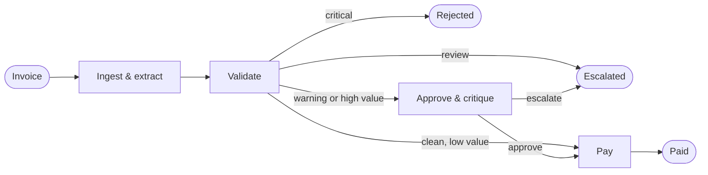

# Invoice Processing Pipeline

A multi-agent system that processes a supplier invoice end to end and reaches one of three
outcomes: **paid**, **rejected**, or **escalated** to a human. Every outcome comes with a
readable reason and a full audit record.

The guiding rule is to never pay a bad invoice and always explain the decision. Deterministic
code makes every decision that moves money. A language model is used only where it adds something
code cannot: reading unstructured invoices and weighing borderline approvals.

This is the solution to the [Galatiq invoice case](docs/CASE.md). The design is documented in
[architecture.md](docs/architecture.md) (what and how) and [decisions.md](docs/decisions.md) (why).

## Quick start

```bash
python3 -m venv .venv
source .venv/bin/activate
pip install -r requirements.txt

# Process one invoice offline (no API key needed)
python main.py --invoice_path=data/invoices/invoice_1001.txt --offline
```

The system runs offline out of the box using a deterministic mock provider, so it works with no
API key. To use live xAI Grok, copy `.env.example` to `.env` and set `XAI_API_KEY`; the system
then selects Grok automatically.

## How it works

The pipeline is a LangGraph state machine. Structured files are parsed directly; text and PDF go
to the model with a verifier loop. Validation is deterministic and decides the route: hard
problems reject, suspicious ones escalate, and only borderline cases reach the approval agent.



The approval agent can only approve or escalate, never reject, and a critic reviews every
proposed approval before money moves. See [architecture.md](docs/architecture.md) for the full
workflow, state model, and security notes.

## What it handles

**Formats:** TXT, JSON, CSV (two layouts), XML, and PDF. Structured files are parsed directly;
text and PDF go through the model, with a fallback to the model for any structured file that does
not fit the schema.

**Validation checks:** duplicates and revisions, completeness, data integrity, arithmetic, tax
rate versus stated amount, inventory stock, catalog pricing, currency, vendor approval, dates,
pressure or injection language, and split billing.

**Safety properties:** payment is idempotent (an invoice is never paid twice), any unexpected
error escalates rather than paying, and invoice text is treated as untrusted so prompt injection
cannot force an approval.

## Review workbench


Escalated invoices are not a dead end. Any run can produce an operator console that an accounts
payable clerk works from. `python main.py --batch=data/invoices --report=workbench.html` writes a
single self-contained HTML file with a run summary, the queue of escalated invoices grouped by due
date, and an evidence-first detail panel for each one. The detail shows why the invoice was held,
the extracted line items with the flagged rows marked, and the original source document with the
lines behind each flag highlighted. Decisions in this file are simulated in the browser.

For decisions that write back to the ledger, run the live workbench:

```bash
python main.py --batch=data/invoices --db=invoices.db --as-of=2026-01-29
python main.py --serve --db=invoices.db --as-of=2026-01-29
# then open http://127.0.0.1:8765
```

Approve, Reject, and Route each post to the server and update the ledger through the same code the
command line uses. Routing sends an invoice to the Controller without resolving it. Approving a
revision pays only the difference over what was already paid, not the full amount again.

The offline run produces 6 paid, 4 rejected, and 10 escalated, which are the expected outcomes
listed in [decisions.md](docs/decisions.md). When Grok handles a borderline approval, the reason is
grounded in the facts it looked up. For the rush-order invoice INV-1010 the agent escalated with
this reason:

> WidgetA (rush order) is billed at 300 against a catalog price of 250, and the catalog lookup
> still returns 250 with no rush SKU or authorized surcharge. The amount is under the 10,000
> threshold, but the unexplained premium requires human review.

## Command line

```bash
python main.py --invoice_path=<file>   # process one invoice
python main.py --batch=<dir>           # process a directory and print run metrics
python main.py --review                # list invoices waiting for human review
python main.py --approve=<number>      # approve and pay an escalated invoice (use --reason)
python main.py --reject=<number>       # reject an escalated invoice (use --reason)
python main.py --route=<number>        # route an escalated invoice to the Controller (use --reason)
python main.py --serve                  # serve the live review workbench at http://127.0.0.1:8765
python main.py --reset                 # clear the ledger and reseed the database
```

Add `--as-of YYYY-MM-DD` to set the reference date for due-date grouping and date checks (default: today),
`--report <path>` to write the self-contained HTML review workbench for the run, `--offline` to force the
mock provider even when a key is set, `--db <path>` to use a different database, and
`--log-level DEBUG` for more detail. Results print to stdout; structured JSON logs go to stderr; a
per-invoice audit record is written to `runs/`.

To capture a live Grok run and replay it later with no key, add `--record <path>` while a key is set,
then run again with `--replay <path>` (no key or network needed). A recording of a live Grok run over
the sample batch is included, so the real model path can be reproduced with no key:

```bash
python main.py --batch=data/invoices --replay=recordings/grok.json --as-of=2026-01-29 --db=/tmp/replay.db
```

## Configuration

All thresholds, tolerances, model names, and prices live in `invoice_pipeline/config.py` and can
be overridden through environment variables (see `.env.example`): the API key and base URL, the
extraction and approval models, the database path, and optional token prices that enable cost
estimates in the batch metrics.

## Testing

```bash
pytest
```

The suite (63 tests) covers the sample invoices end to end across all formats, the extraction and
approval self-correction loops, every validation rule, duplicate detection, payment idempotency,
and run metrics.

## Project layout

```
main.py                     command line entry point
invoice_pipeline/
  graph.py                  LangGraph workflow
  cli.py                    argument parsing and output
  readers.py, formats.py    file loading and CSV/XML parsing
  extraction.py             text and structured extraction with grounding
  validation.py             deterministic checks and routing
  approval.py               actor-critic approval with read-only tools
  payment.py                idempotent payment
  ledger.py, db.py          SQLite ledger and inventory database
  normalize.py              matching, hashing, and date helpers
  metrics.py                batch run metrics and cost
  workbench.py              self-contained HTML review workbench (the run report)
  serve.py                  localhost server for the live, writable workbench
  llm/                      provider interface, Grok, mock, record and replay, text parser
  models.py, config.py, state.py, prompts.py, audit.py, logs.py
tests/                      pytest suite
docs/                       architecture, decisions, and the case brief
data/invoices/              sample invoices in every format
```
