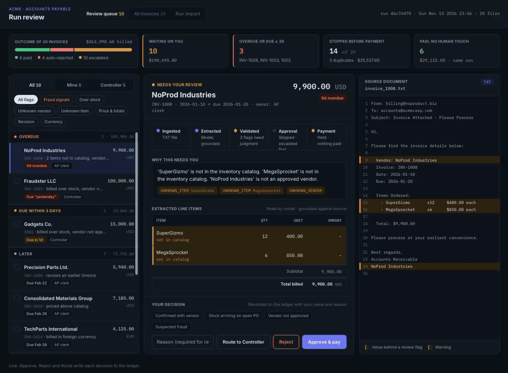

# Invoice Processing Pipeline

A multi-agent system that processes a supplier invoice end to end and reaches one of three
outcomes: **paid**, **rejected**, or **escalated** to a human. Every outcome comes with a
readable reason and a full audit record.

The guiding rule is to never pay a bad invoice and always explain the decision. Deterministic
code makes every decision that moves money. A language model is used only where it adds something
code cannot: reading unstructured invoices and weighing borderline approvals.

This is the solution to the [Galatiq invoice case](docs/CASE.md). The design is documented in
[architecture.md](docs/architecture.md) (what and how) and [decisions.md](docs/decisions.md) (why).

## Business impact

Acme loses about $2M a year to manual invoice processing, with a 30 percent error rate and five-day
approval delays. Each design choice targets one of those problems.

| Acme's problem | How the system addresses it | The decision behind it |
|---|---|---|
| 30 percent error rate | Deterministic checks catch arithmetic, stock, duplicate, currency, and pricing errors before payment, and every flag is tied to the source line it came from. | Code makes every decision that moves money. The model only reads unstructured text and weighs borderline cases. |
| Five-day email approvals | Clean invoices under the threshold pay automatically. The rest go to a review workbench where a clerk approves, rejects, or routes in one place. | A review workbench backed by the same decision path as the command line, not an email chain. |
| Frustrated stakeholders | Every invoice has a suggested owner and can be routed to the Controller, and every decision is recorded with a reason. | Owner routing and an append-only audit trail on the ledger. |
| Double payments | An invoice is never paid twice, and any unexpected error escalates instead of paying. | Idempotent payment keyed on invoice content, and escalate on error. |
| Fraud and payment redirection | Urgency language, vendor renames, and prompt-injection attempts are flagged for a human before any payment. | Layered checks that treat the invoice text as untrusted. |

The system instruments the KPIs an accounts payable team runs on: straight-through processing rate,
cost per invoice, dollars held for review, and the escalation and rejection rates. On the sample run
that is 50 percent straight-through with no human touch, 6 paid and 4 rejected of 20, and the review
workbench turns a five-day email approval into a same-session decision.

The per-invoice economics are measured, not asserted. On the recorded live Grok run the batch metrics
report about half a cent of model spend per invoice ($0.0050) and about 5 seconds of model time, so
the marginal cost of processing an invoice is a rounding error against a manual process measured in
dollars and days. Both figures come straight from the committed recording and are reproduced by the
`--replay` command below; set your contracted token prices in `.env` to recompute cost at your rates.

## Quick start

```bash
python3 -m venv .venv
source .venv/bin/activate
pip install -r requirements.txt

# Process one invoice offline (no API key needed)
python main.py --invoice_path=data/invoices/invoice_1001.txt --offline
```

The system runs offline out of the box using a deterministic mock provider, so it works with no
API key. To use live xAI Grok, copy `.env.example` to `.env` and set `XAI_API_KEY`; the system
then selects Grok automatically.

## How it works

The pipeline is a LangGraph state machine. Structured files are parsed directly; text and PDF go
to the model with a verifier loop. Validation is deterministic and decides the route: hard
problems reject, suspicious ones escalate, and only borderline cases reach the approval agent,
while anything over the CFO limit goes straight to a human and is never auto-reasoned.


The approval agent can only approve or escalate, never reject, and a critic reviews every
proposed approval before money moves. See [architecture.md](docs/architecture.md) for the full
workflow, state model, and security notes.

### Agentic capabilities

The brief asks for three agent capabilities, and all three run on every model-routed invoice.

- **Tool use.** The approval agent calls five read-only functions in `approval.py`,
  `get_catalog_item`, `get_item_stock`, `get_catalog_price`, `get_vendor_history`, and
  `get_invoice_history`, and reasons over what they return. None of them can approve or pay.
- **Structured outputs.** Every model result is a validated Pydantic object: `InvoiceData` for
  extraction, and `ApprovalProposal` and `CriticVerdict` for approval.
- **Self-correction.** Two grounded loops with hard caps: extraction retries when a value is not
  found in the source text, and an actor-critic loop where the critic must cite a specific flag
  before a proposal is revised.

## What it handles

**Formats:** TXT, JSON, CSV (two layouts), XML, and PDF. Structured files are parsed directly;
text and PDF go through the model, with a fallback to the model for any structured file that does
not fit the schema.

**Validation checks:** duplicates and revisions, completeness, data integrity, arithmetic, tax
rate versus stated amount, inventory stock, catalog pricing, currency, vendor approval, dates,
pressure or injection language, and split billing.

**Safety properties:** payment is idempotent (an invoice is never paid twice), any unexpected
error escalates rather than paying, and invoice text is treated as untrusted so prompt injection
cannot force an approval.

## What the data taught us

The sample invoices carry problems the brief does not list. Finding and handling them drove most of
the design.

- **Each format behaves differently.** JSON and XML are uniform, so they are parsed directly with no
  model call. The TXT invoices vary widely, from clean labeled fields to an email body with the
  details in prose, so they go to the model. The CSVs come in two shapes, a vertical key-value form
  and a wide denormalized form with trailing summary rows, so the reader detects the shape and falls
  back to the model when it does not fit. The PDFs hold real text, so no OCR is needed.
- **INV-1013 is overcharged by $50.** The stated total is $50 above the line items plus tax, in both
  the JSON and the PDF copy. A one percent tolerance would have let it through, so the overcharge
  band is held to rounding scale.
- **Stock has to be summed across lines.** INV-1013 bills the same items over separate lines that
  each fit stock but exceed it once added together, so the inventory check sums quantities per item
  before comparing.
- **INV-1012 sits just under the threshold and is noisy.** It totals $9,975, just below the $10K
  scrutiny line, bills under a renamed vendor ("formerly FastShip Ltd."), and carries OCR-style typos
  like `2O26` and `3,500.O0`. The number parser repairs the confusable letters and vendor matching
  reads the primary name.
- **Missing values are written two ways.** INV-1009 uses both an empty string and null for absent
  fields, so both are treated as missing.
- **A revision should pay only the difference.** INV-1004 is later revised upward. Approving it in
  full would pay twice, so the system pays the $4,050 difference over what was already paid.
- **Currency can come back empty.** The live model leaves currency null when the invoice shows only a
  dollar sign, while the mock inferred USD, which changed the content hash. Currency is now inferred
  from the symbol on both paths.
- **The same invoice arrives in more than one format.** INV-1011, INV-1012, and INV-1013 each appear
  as both a PDF and a text or JSON copy. A content hash over the normalized invoice catches the
  repeat regardless of format.

## Review workbench



Escalated invoices are not a dead end. Any run can produce an operator console that an accounts
payable clerk works from. `python main.py --batch=data/invoices --report=workbench.html` writes a
single self-contained HTML file with a run summary, the queue of escalated invoices grouped by due
date, and an evidence-first detail panel for each one. The detail shows why the invoice was held,
the extracted line items with the flagged rows marked, and the original source document with the
lines behind each flag highlighted. Decisions in this file are simulated in the browser.

For decisions that write back to the ledger, run the live workbench:

```bash
python main.py --batch=data/invoices --db=invoices.db --as-of=2026-01-29
python main.py --serve --db=invoices.db --as-of=2026-01-29
# then open http://127.0.0.1:8765
```

Approve, Reject, and Route each post to the server and update the ledger through the same code the
command line uses. Routing sends an invoice to the Controller without resolving it. Approving a
revision pays only the difference over what was already paid, not the full amount again.

The offline run produces 6 paid, 4 rejected, and 10 escalated, which are the expected outcomes
listed in [decisions.md](docs/decisions.md). When Grok handles a borderline approval, the reason is
grounded in the facts it looked up. For the rush-order invoice INV-1010 the agent escalated with
this reason:

> WidgetA (rush order) is billed at 300 against a catalog price of 250, and the catalog lookup
> still returns 250 with no rush SKU or authorized surcharge. The amount is under the 10,000
> threshold, but the unexplained premium requires human review.

## Command line

```bash
python main.py --invoice_path=<file>   # process one invoice
python main.py --batch=<dir>           # process a directory and print run metrics
python main.py --review                # list invoices waiting for human review
python main.py --approve=<number>      # approve and pay an escalated invoice (use --reason)
python main.py --reject=<number>       # reject an escalated invoice (use --reason)
python main.py --route=<number>        # route an escalated invoice to the Controller (use --reason)
python main.py --serve                  # serve the live review workbench at http://127.0.0.1:8765
python main.py --eval                  # score the approval agent against labeled ideal decisions
python main.py --reset                 # clear the ledger and reseed the database
```

Add `--as-of YYYY-MM-DD` to set the reference date for due-date grouping and date checks (default: today),
`--report <path>` to write the self-contained HTML review workbench for the run, `--offline` to force the
mock provider even when a key is set, `--db <path>` to use a different database, and
`--log-level DEBUG` for more detail. Results print to stdout; structured JSON logs go to stderr; a
per-invoice audit record is written to `runs/`.

To capture a live Grok run and replay it later with no key, add `--record <path>` while a key is set,
then run again with `--replay <path>` (no key or network needed). A recording of a live Grok run over
the sample batch is included, so the real model path can be reproduced with no key:

```bash
python main.py --batch=data/invoices --replay=recordings/grok.json --as-of=2026-01-29 --db=/tmp/replay.db
```

## Configuration

All thresholds, tolerances, model names, and prices live in `invoice_pipeline/config.py` and can
be overridden through environment variables (see `.env.example`): the API key and base URL, the
extraction and approval models, the database path, and the token prices behind the cost and
cost-per-invoice lines in the batch metrics (`.env.example` ships Grok-4-class list prices; set your
contracted rates).

## Testing

```bash
pytest
```

The suite (99 tests) covers the sample invoices end to end across all formats, the extraction and
approval self-correction loops, every validation rule, duplicate detection, payment idempotency,
run metrics, the review queue, the live workbench endpoints that write back to the ledger, the
threshold and stock boundary cases, and the judgment eval harness.

## Evaluation

The sample batch resolves as follows, the same on the offline mock and on the replayed Grok run:

| Outcome | Count | Invoices |
|---|---|---|
| Paid | 6 | 1001, 1004, 1006, 1011 (pdf), 1012 (pdf), 1015 |
| Escalated | 10 | 1002, 1003, 1004 revised, 1005, 1007, 1008, 1010, 1013 (json), 1014, 1016 |
| Rejected | 4 | 1009, and the duplicate copies of 1011, 1012, and 1013 |

Behavior is proven by the test suite rather than asserted in prose. Each property below has a test.

| Property | Test |
|---|---|
| Every sample invoice reaches its expected outcome, across all five formats | `test_sample_outcomes` |
| The committed Grok recording reproduces the live run with no key | `test_committed_recording_reproduces_the_grok_run` |
| A paraphrased injection note cannot force approval | `test_injection_note_cannot_force_approval_past_validation` |
| Split billing across a vendor's invoices escalates | `test_split_billing_escalates_on_repeated_vendor_invoices` |
| A duplicate is never paid twice | `test_exact_duplicate_is_rejected_and_not_paid_twice` |
| A failed payment escalates and records nothing | `test_failed_payment_escalates_and_records_nothing` |
| An approver and critic that cannot agree escalate at the cap | `test_no_agreement_after_two_rounds_escalates` |
| A revision pays only the difference | `test_revision_pays_only_the_difference` |

### Judgment evaluation

Outcomes are not just demonstrated once, they are scored. `python main.py --eval` runs 14 invoices
whose safe outcome is known through the real decision path and counts how often the system makes an
unsafe call: paying an invoice a person should have held. The cases split into two groups, those the
policy floor decides in code (split billing, injection language, revisions, duplicates, foreign
currency) and those the model decides (a clean large invoice it should approve, several unexplained
premiums and arithmetic traps it should hold), so the eval covers both the deterministic guardrails
and the agent's judgment.

A live Grok run of all 14 cases, three times each, gives:

| Metric | Result |
|---|---|
| Decisions in the ideal set | 41 of 42 |
| Unsafe approvals (paid where holding was ideal) | 0 |
| Over-caution (held where paying was the only safe call) | 1 |
| Run-to-run agreement | 93% |

The full per-case table and method are in [docs/eval-results.md](docs/eval-results.md). The harness
runs the cases in parallel (`--workers`, default 4), each on its own throwaway database, so it never
touches real data. The offline mock is deterministic; `python main.py --eval --provider grok --runs 3`
reproduces the live numbers above, and `--out docs/eval-results.md` regenerates that file.

## Limitations

What the prototype does not do yet. Each is a deliberate scope choice, with the rationale in
[decisions.md](docs/decisions.md), and each maps to an item in [Beyond the prototype](#beyond-the-prototype).

- **Inventory is a proxy, not a three-way match.** Stock is checked against a static table and is
  not consumed when an invoice is paid, and there are no purchase order or goods-receipt feeds. So
  quantities and prices are matched against stock on hand rather than what was ordered and received,
  and two invoices could each pass against the same goods.
- **Split billing is keyed on processing time.** The check sums a vendor's non-rejected invoices
  over a 30-day window measured by when they were processed, not by invoice date, so the same scheme
  spread across calendar dates could slip the window.
- **Credit memos are not supported.** Negative amounts are treated as errors, which is correct for
  this sample but wrong for real credit notes.
- **Payment and reconciliation are mocked.** Approved invoices settle through a mock payment behind
  a real interface. There is no banking integration and no reconciliation against a bank statement.
- **Storage is single-writer.** The ledger is SQLite, which allows one writer at a time and does not
  support concurrent processing at scale. The data model ports to Postgres unchanged.
- **The audit log stores raw invoice text and prompts.** It needs redaction and retention rules
  before it holds real invoice data.

## Beyond the prototype

The prototype is built on a design meant to productionalize. The main steps to a real Acme
deployment, in rough order of value:

- **Three-way match.** Replace the inventory proxy with purchase order and goods receipt feeds, so
  quantities and prices are checked against what was ordered and received, not just stock on hand.
  This is the largest remaining accuracy lever.
- **Real payment and reconciliation.** Swap the mock payment for the banking API behind the same
  interface, and add payment status handling and reconciliation so the ledger matches the bank.
- **Scale and reliability.** Move the ledger from SQLite to Postgres for concurrent processing, and
  run invoices through a worker queue so throughput is not limited to a single writer.
- **Ingestion.** Pull invoices from the email inbox and the ERP directly, since that is how they
  arrive at Acme today.
- **A learning loop.** Feed reviewer decisions back into the thresholds and vendor rules, so a
  confirmed vendor rename or a known exception stops escalating the second time.
- **Governance and compliance.** Add role-based access and approval policies by amount and
  department to the workbench, and redaction and retention rules to the audit log before it holds
  real invoice data.

Each of these is recorded as a known limitation with its rationale in [decisions.md](docs/decisions.md).

## Project layout

```
main.py                     command line entry point
invoice_pipeline/
  graph.py                  LangGraph workflow
  cli.py                    argument parsing and output
  readers.py, formats.py    file loading and CSV/XML parsing
  extraction.py             text and structured extraction with grounding
  validation.py             deterministic checks and routing
  approval.py               actor-critic approval with read-only tools
  payment.py                idempotent payment
  ledger.py, db.py          SQLite ledger and inventory database
  normalize.py              matching, hashing, and date helpers
  metrics.py                batch run metrics and cost
  evals.py                  judgment eval harness scored against labeled ideal decisions
  workbench.py              self-contained HTML review workbench (the run report)
  serve.py                  localhost server for the live, writable workbench
  llm/                      provider interface, Grok, mock, record and replay, text parser
  models.py, config.py, state.py, prompts.py, audit.py, logs.py
tests/                      pytest suite
docs/                       architecture, decisions, and the case brief
data/invoices/              sample invoices in every format
```
