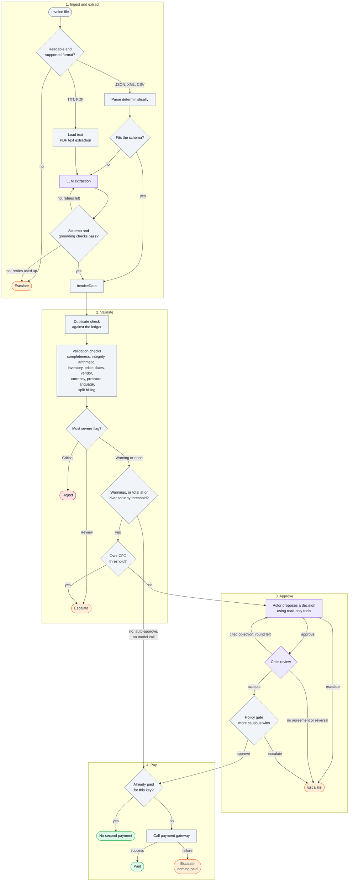

# Architecture

## Overview

The system takes one invoice file and ends in exactly one of three outcomes: paid, rejected, or escalated to a human. Every outcome comes with a readable reason and a full audit record.

The guiding rule is: never pay a bad invoice, and always explain the decision. To make that hold, deterministic code makes every decision that moves money. The LLM is used only where it adds something code cannot: reading unstructured invoices, and weighing borderline approvals. The reasoning behind these choices is in [decisions.md](decisions.md).

## Implementation status

This document describes the full target design. The current build runs the pipeline end to end on TXT and JSON invoices, using the Grok provider when an API key is set and a deterministic mock provider otherwise. Items marked (planned) below are designed but not yet implemented. The build order is listed under [Scope](decisions.md#scope) in the decisions document. The planned items are the XML, CSV, and PDF readers, the date, vendor, currency, pressure-language, and split-billing validation checks, recorded model responses, and the run-level metrics.

## Workflow

The pipeline is a LangGraph state machine in four stages. The chart shows every path an invoice can take.

How to read it:

- Purple steps call the model. Grey steps are plain code.
- Green, red, and orange are the three outcomes: paid, rejected, and escalated to a human.
- Critical flags include an exact duplicate, a negative quantity, or a missing vendor. Review flags include a revision, an unknown item, overstock, or a possible rebill. The full list is under [Validation](#2-validation).
- Every outcome writes a record to the ledger and an audit file. Escalated invoices appear in the review queue.
- An unexpected error at any step also escalates. It is left off the chart to keep it readable.

## Stages

### 1. Ingestion and extraction

Ingestion picks a reader by file extension and loads the content. Extraction turns it into a typed `InvoiceData` object.

| Format | What the samples look like | How it is read |
|---|---|---|
| JSON | Uniform, with a nested vendor object | Parsed directly |
| XML | Uniform nested structure; one sample is in EUR | Parsed directly with a hardened parser (planned) |
| CSV | Two layouts: vertical key-value, and one row per line item | Parsed directly for both known layouts, model fallback otherwise (planned) |
| TXT | Varied: labeled fields, misspelled headers, an email, column tables | Model |
| PDF | Native text, no scans | Text extracted, then model (planned) |

Rules that apply on every path:

- Extraction records values as written. A quantity of -5 stays -5, and a missing field stays empty. Finding problems is the job of validation.
- If a structured file does not parse or does not fit the schema, it falls back to the model.
- An unreadable or unsupported file escalates, since nobody could read it.

On the model path, extraction runs a verifier loop. The output is checked against the Pydantic schema, and every extracted value is checked against the source text (after normalizing case, spacing, currency symbols, separators, and OCR slips such as the letter O for a zero). If either check fails, the exact error goes back to the model for another try. After the retry cap, the invoice escalates.

### 2. Validation

Validation is plain code and makes no model call. It runs these checks and records a flag for each problem:

1. Duplicates and revisions, against the ledger, using a hash of the normalized invoice content.
2. Completeness: invoice number, vendor, total, and at least one line item.
3. Data integrity: no negative or zero quantities, no negative totals.
4. Arithmetic: line amounts plus tax, shipping, and fees match the total, within a tolerance.
5. Inventory: quantities are summed per item, then checked for unknown items, zero stock, and overstock.
6. Price: each line's unit price against the catalog price, within a tolerance. An overcharge beyond rounding raises a Warning.
7. Dates: present, parseable, not ambiguous, past-due status. (planned)
8. Vendor: known and approved. (planned)
9. Currency: one the company can settle. (planned)
10. Pressure and injection language in free text. (planned)
11. Split billing: a vendor's invoices over a recent window adding up past the scrutiny threshold. (planned)

Each flag has a severity, and the severity decides the route:

| Severity | Meaning | Route |
|---|---|---|
| Critical | Definitely invalid, nothing a human could fix (missing vendor or total, negative values, exact duplicate) | Reject |
| Review | Suspicious but could be legitimate (unknown item, overstock, revision, possible rebill, number collision) | Escalate, without calling the model |
| Warning | Soft signal (small arithmetic or price variance, past due) | Approval agent |

An invoice with no flags under the scrutiny threshold (10,000 by default) is approved by code with no model call. Anything with only warnings, or at or above the threshold, goes to the approval agent.

### 3. Approval

The approval agent only sees invoices that passed the hard checks, so it only handles genuine judgment calls.

- It receives structured fields and findings, not the raw document. Free text is passed as labeled, untrusted data.
- It can approve or escalate. It cannot reject, because rejection is reserved for the deterministic checks.
- It can call read-only tools to look up stock, catalog price, and the vendor's recent invoices.
- A critic reviews every proposed approval against the rules and findings, and must cite a specific flag or fact to object. The actor gets up to two rounds to resolve objections. If they do not agree, or the actor reverses itself, the invoice escalates.
- Above the CFO threshold (50,000 by default), the invoice always escalates for human sign-off.
- The final decision is the more cautious of the agent and the policy, so the model can never make an outcome less cautious.

### 4. Payment and ledger

Payment is plain code and runs only on a final approve. It uses an idempotency key (invoice number plus content hash), so re-running an invoice cannot pay twice. If the payment call fails, nothing is marked paid and the invoice escalates. It is never retried blindly.

Every invoice, whatever its outcome, is written to the ledger. The ledger is what the duplicate check reads on later runs.

## LLM providers

Nodes call one interface: a prompt and a target schema in, a validated object out. Two backends sit behind it today, and the provider is chosen automatically:

1. xAI Grok, when an API key is set. The API is OpenAI-compatible, so other providers are easy to add.
2. A deterministic mock, used when there is no key or when the run is forced offline, so the system always runs. The mock can return malformed output on demand to test the extraction loop.

A third backend, recorded real responses replayed offline for the sample invoices, is planned.

## State and audit log

The LangGraph state is one Pydantic model holding the `InvoiceData`, the workflow fields (retry counters, flags, decision, payment result), and an append-only audit log. Each audit event has a one-line summary (stage, outcome, reason) and a detail layer with inputs, outputs, and, for model calls, the prompt and response. The full record for each invoice is written to a JSON file.

## Data model

SQLite, with four tables:

- `inventory`: item, stock, unit price. Seeded with WidgetA 15 at 250, WidgetB 10 at 500, GadgetX 5 at 750, and FakeItem 0.
- `vendors`: name, approved.
- `invoices_processed` (the ledger): invoice number, vendor, content hash, total, currency, status, reasons, payment reference, timestamp. Indexed on the lookup columns.
- `payments`: one row per successful payment, keyed by the idempotency key, so a payment is never made twice.

## Security

Invoice text is treated as untrusted. The defense does not rely on the model resisting prompt injection:

- The model has no payment or approval tool. It only proposes a decision, and code decides what happens.
- Validation and the policy floor run independently of the model and cannot be overridden by it.
- Suspicious invoices escalate before the model ever sees them, and injection-style language is itself a flag.
- The extraction grounding check stops injected values that are not in the source.

Other controls: SQL queries use bound parameters, XML parsing disables external entities, and API keys stay in an untracked environment file and are never logged.

## Running it

- `python main.py --invoice_path=<file>` processes one invoice and prints the outcome and reasons.
- `python main.py --review` lists escalated invoices with their reasons.
- `python main.py --reset` clears the ledger and reseeds the database.
- `--offline` forces the offline provider even when an API key is set.

## Operations

- Any unexpected error escalates. The system never fails into a paid state.
- Model calls get bounded retries with backoff, and both loops have hard caps.
- Cost stays low because clean invoices and structured files never call the model. A cheaper model handles extraction, and a stronger one handles approval.
- Run-level metrics are planned: the straight-through, escalation, and rejection rates, dollars paid versus held, and cost per invoice.
- All thresholds, tolerances, retry caps, and model names live in one config module.
